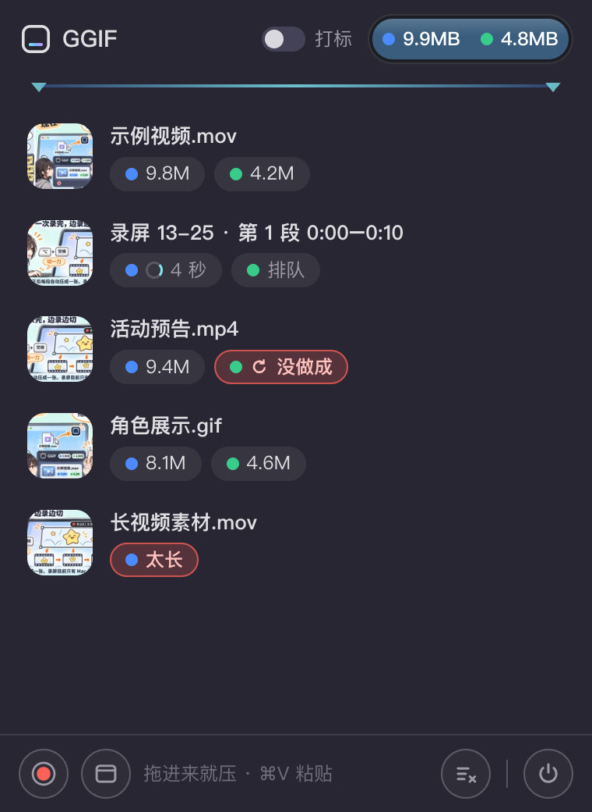
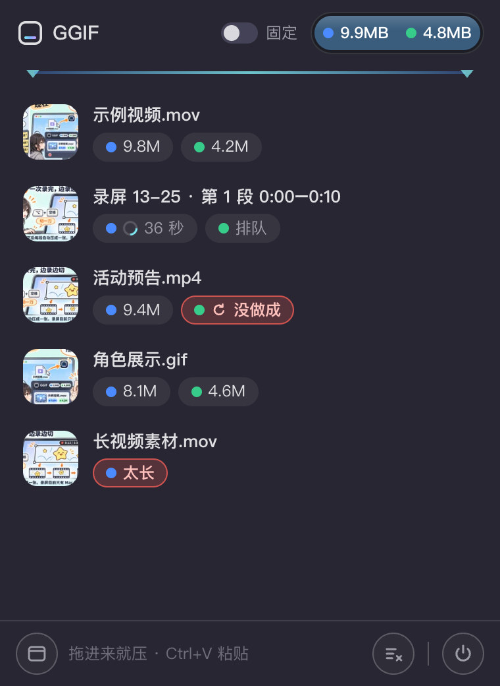
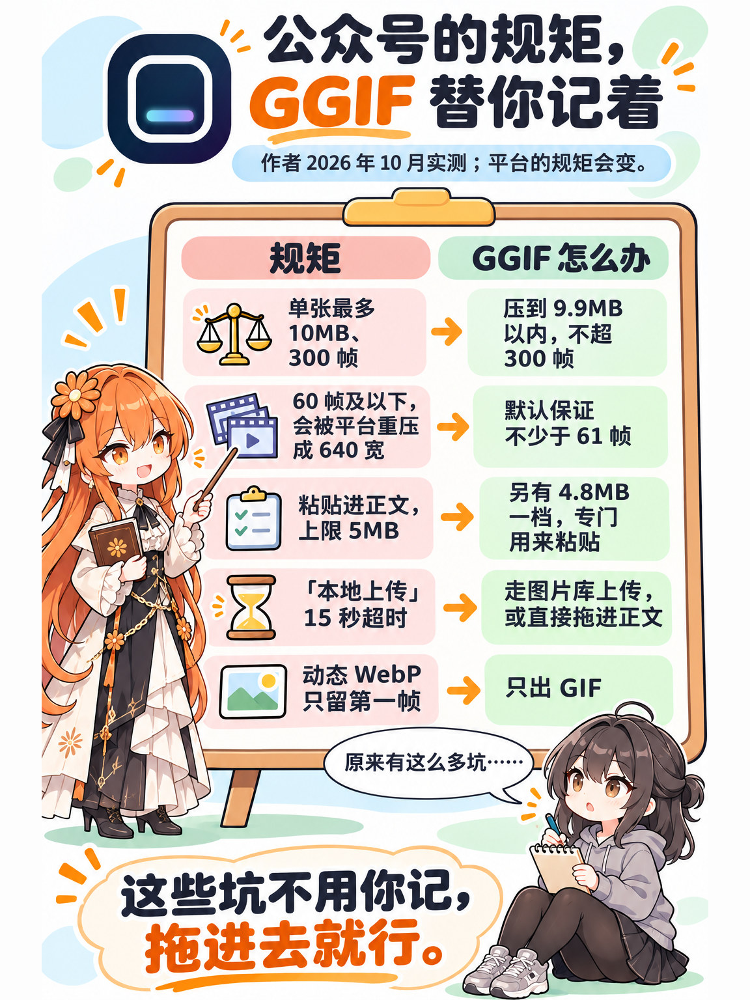

<picture>
  <source media="(prefers-color-scheme: dark)" srcset="docs/logo/ggif-lockup-dark.svg">
  
</picture>

# GGIF

给微信公众号用的 GIF 压缩工具：把 GIF 或视频拖进去，出来的就是能直接发公众号的动图。Mac 和 Windows 都有。

<p>
  
  
</p>

<sub>左：Mac 菜单栏里的面板；右：Windows 托盘里的面板。每个文件可以同时出 9.9MB 和 4.8MB 两个版本，压好直接从列表拖进公众号正文。</sub>

公众号对动图有一串规矩：单张 10MB 以内、最多 300 帧、粘贴进去的还得更小、帧数太少会被平台重新压一遍（见下面「公众号的规矩」）。每张图自己试参数很费时间。GGIF 把这些规矩做成了预设，拖进去就行。

## 四张图看懂





<sub>四张图由 Codex（ChatGPT）的生图工具生成，人设和 <a href="https://github.com/NPCONTEXT/Qlimen">Qlimen</a>、<a href="https://github.com/NPCONTEXT/Qlimen-Tabula">无限表格</a>的图是同一套。拼成一张的长图在 <a href="docs/漫画/GGIF-一图流.jpg">docs/漫画/GGIF-一图流.jpg</a>。</sub>

---

## 30 秒看懂

1. **现成的 GIF、视频**：拖到 GGIF 的图标上就压，不用调参数。Mac 上把 GIF 的打开方式设成 GGIF 以后，双击就压，结果放在原文件旁边；本来就合格的不会重复压。
2. **要自己录屏**（Mac）：一次录完。录的时候看到该分开的地方按一下切一刀，停下后按刀切成几段，每段自动压成一张。
3. **想自己细调**：完整界面里能剪一段、裁画面，改宽度、帧率、画质，改完马上看到预计多大。
4. **两个档**：**9.9MB** 的用来在图片库上传、或者直接拖进正文；**4.8MB** 的用来复制粘贴。**三种速度**：默认「极速」，日常素材一般几秒一张；「标准」「极限」更慢，画质更好。

## 名字

作者的话：

> GG + GIF：GG 是游戏里的 Good Game，也有结束、终结的意思。我们的目标就是终结公众号 GIF 压缩难题。GGIF 念起来像结巴：G、GIF，名字本身就有点搞笑，也容易记住，别人光听到我的名字，就已经吓得说不利索了。游戏文化属性：工具本身服务游戏媒体编辑，GG 又是玩家熟悉的表达，契合使用场景。

## 下载和安装

到[发布页](https://github.com/NPCONTEXT/GGIF/releases)下最新版：

| 你的电脑 | 下哪个 |
|---|---|
| Mac，Apple 芯片（M1 及以后） | `GGIF-版本号-arm64.dmg` |
| Mac，Intel 芯片 | `GGIF-版本号-Intel.dmg` |
| Windows 10、11（64 位） | `GGIF-版本号-Setup.exe`（安装版）或 `GGIF-版本号-win-x64.zip`（免安装，解开双击 GGIF.exe） |

Mac 要 macOS 14 及以上。不知道是哪种芯片：点屏幕左上角的苹果 →「关于本机」，看「芯片」或「处理器」那一行。

安装包没有买苹果和微软的签名，第一次打开会被系统拦一下。

**Mac 第一次打开**

1. 把 GGIF 拖到「应用程序」，双击它，弹出提示后点「完成」。
2. 打开「系统设置 → 隐私与安全性」，往下拉到「安全性」，点 GGIF 旁边的「仍要打开」。
3. 再弹出提示时点「仍要打开」，输入这台 Mac 的登录密码。以后就能直接打开了。

打开后，屏幕右上角的菜单栏里会出现 GGIF 的图标（一个圆角方框）。如果压缩时提示打不开 ffmpeg 或 gifsicle，打开「终端」粘贴下面这行、回车，再退出 GGIF 重新打开：

```bash
xattr -dr com.apple.quarantine /Applications/GGIF.app
```

**Windows 第一次运行**

弹出「Windows 已保护你的电脑」时，点「更多信息」→「仍要运行」。安装版装在你自己的用户目录，不要管理员密码。装好后任务栏右下角的托盘里会出现 GGIF 的图标，Windows 11 可能把它藏在「^」里。

如果只有「不运行」、没有「仍要运行」，或者提示被「智能应用控制」阻止：那是 Windows 11 拦下了没签名的程序，GGIF 这边目前没有办法。

## 怎么用

下面是简版；带截图的完整说明见 [docs/使用说明.md](docs/使用说明.md)。

**压现成的 GIF 和视频**

- 把 GIF、视频或者整个文件夹拖到 GGIF 的图标上（Mac 在右上角菜单栏，Windows 在右下角托盘）。压好的在面板的列表里，直接拖进公众号正文；可以多选一起拖。
- 面板顶上的 9.9MB、4.8MB 两个档可以都点亮，每张同时出两版，想用哪个拖哪个。
- 也可以复制文件后在面板里粘贴（Mac ⌘V，Windows Ctrl+V）。

**录屏（Mac）**

- 按 ⌃⌥R（或者点面板左下角的红点），系统会先问录哪个屏幕或窗口。
- 出现录制框和右上角的小胶囊：拖四角改大小。胶囊上勾「打标」才能边录边切，勾「录完自动压」停了就自动压好。
- 录的时候按 ⌥空格 切一刀，切几刀就多出几段。一次最长 90 秒。
- 原始录像放在「下载/GGIF录屏」，GGIF 不会自动删。录出来的画面不带鼠标。

**发到公众号**

- 9.9MB 那份：拖进正文，或者在编辑器里点「图片 → 从图片库选择 → 上传文件」。别用「本地上传」，它 15 秒就超时，大图常常传不上。
- 4.8MB 那份：复制粘贴用。
- 拖进正文时，松手要落在正文里有字或有光标的那一行；落在两边或最后一段下面的空白处，编辑器不接，浏览器会把图片开在新标签页。

**Windows 版不一样的地方**

- 图标在右下角的托盘里：单击开关面板，双击打开完整界面。
- 把文件拖到托盘图标上，图标上方先冒出提示，停一下面板弹出来，拖进面板松手就压。
- Mac 的 ⌘ 在 Windows 上都是 Ctrl；完整界面里切一刀是 Ctrl+B，设置里能换。
- 这一版还没有录屏，也不能双击 GIF 用 GGIF 打开。

## 公众号的规矩

下面是作者 2026 年 10 月在自己的公众号上实测到的，GGIF 的预设就是照这些定的。平台的规矩会变，发现对不上了欢迎提 issue。

- 单张动图上限 10MB，最多 300 帧，多一帧就传不上去。
- 60 帧及以下的 GIF，读者看到的是被平台重新压过、缩到 640 宽的版本；61 帧及以上才原样下发。所以 GGIF 默认保证输出不少于 61 帧。
- 宽度超过 1080 的，上传时就会被缩小并重新编码。
- 编辑器里「图片 → 本地上传」15 秒超时；「从图片库选择 → 上传文件」不限时。
- 粘贴进正文的 GIF 上限是 5MB，所以另有 4.8MB 这一档。
- 动态 WebP 不行，平台只留第一帧。

## 已知限制

- 只在作者和几位同事的电脑上用过。
- 没有签名，没有自动更新；出了新版要自己再下。
- Windows 版这一版只有压缩。
- 素材上限：GIF 200MB、视频 100MB；更大的先用剪辑软件截一段再拖进来。
- 录屏的框出来（胶囊上显示「准备好了」）以后别直接退出 GGIF，先点胶囊上的「取消」，不然会退不干净。
- 界面只有中文。

## 从源码运行

要准备的：

- Node 24。
- ffmpeg、ffprobe、gifsicle，能在命令行里直接叫到（Mac 上可以 `brew install ffmpeg gifsicle`）。
- [lessgif](https://github.com/moonjuho11/lessgif) 的 `lessgif.wasm`（必需）和 [gifski](https://github.com/ImageOptim/gifski) 的程序（平时可选，只有自定义里选 gifski 编码时才用；跑测试要有）。放进 `engine/vendor/`，或者用环境变量 `GIFKIT_LESSGIF_WASM`、`GIFKIT_GIFSKI` 指过去。

```bash
git clone https://github.com/NPCONTEXT/GGIF.git
cd GGIF/app
npm install
./node_modules/.bin/electron .
```

跑测试：

```bash
cd engine && GIFKIT_NO_PRIVATE_SAMPLES=1 npm test
cd ../app && GIFKIT_NO_PRIVATE_SAMPLES=1 node --test 'test/*.test.js'
```

作者本机有一批没有公开的测试素材；带上 `GIFKIT_NO_PRIVATE_SAMPLES=1`，要用到这些素材的测试会跳过。

打包：Mac 的打包脚本是 `app/scripts/build-encoders.mjs`（从源码编 ffmpeg 等）和 `app/scripts/pack.mjs`，它们按作者本机的目录结构找工具，照搬要改里面的路径。Windows 的打包在 `.github/workflows/` 里，在 GitHub 的 Windows 机器上跑。

## 目录

- `app/`：界面和主进程（Electron）。
- `engine/`：压缩引擎，纯 Node，调用外部的编码程序。用法见 `engine/README.md`。
- `.github/workflows/`：Windows 版的云端测试和打包。
- `docs/`：使用说明、截图、四张漫画和标志。
- `third_party/`：随包程序的许可证。

## 关于代码里的注释

注释是开发过程中留下来的。「作者：『……』」是作者当时提要求的原话；「某某卷」「11.13」「W11e」这类编号，还有 `GIF工具/…` 这类路径，指的是没有公开的开发记录。

## 许可证

GGIF 自己的代码按 [MIT](LICENSE) 发布。安装包里带的 ffmpeg、gifsicle、gifski 等程序各有各的许可证，见[第三方声明](THIRD_PARTY_NOTICES.md)。GGIF 的标志（`docs/logo/` 里的图形和字标）不随 MIT 授权，介绍、链接本项目时可以用。标志的字体是 Outfit 和思源黑体（都是 SIL OFL 1.1），SVG 里的字已转成曲线。四张漫画由 Codex（ChatGPT）的生图工具生成；截图里的示例画面取自这四张漫画。

更新记录见 [更新日志](更新日志.md)。
