# GGIF 使用说明

对应版本 0.6.0。

截图是 GGIF 的真界面，里面的文件名和数字是示例；标着「示意图」的是自己画的，不是真实截图。Windows 的几张是同一套界面按 Windows 的样子截的，字体以实际为准。图里 GGIF 标志用的是新配色（短条从青到紫）；0.6.0 的程序里，图标和左上角的小标还是原来的青色条，之后的版本再换。

- [1. GGIF 方便在哪](#1-ggif-方便在哪)
- [2. 装上它](#2-装上它)
- [3. 压现成的 GIF 和视频](#3-压现成的-gif-和视频)
- [4. 录屏（Mac）](#4-录屏mac)
- [5. 发到公众号](#5-发到公众号)
- [6. 完整界面：剪、裁、细调](#6-完整界面剪裁细调)
- [7. 设置](#7-设置)
- [8. Windows 版有什么不一样](#8-windows-版有什么不一样)
- [9. 注意](#9-注意)
- [10. 遇到问题](#10-遇到问题)

## 1. GGIF 方便在哪

**有现成的 GIF：双击就完事**

双击 GIF，GGIF 在后台把它处理成能直接传公众号的版本（9.9MB 以内）：不用打开软件，不用调参数，结果就在原文件旁边。本来就合格的，不会重复压。（第一次要把 GIF 的打开方式设成 GGIF，见第 3 节；Windows 版这一版还没有。）

一次很多张：把 GIF、视频或整个文件夹拖到 GGIF 的图标上（Mac 在屏幕右上角的菜单栏，Windows 在右下角的托盘），压好后从列表直接拖进公众号正文。

两个版本随便拿：把面板顶上的 9.9MB、4.8MB 两个档都点亮，每张同时出两版。9.9MB 的适合图片库上传、直接拖进正文；4.8MB 的适合复制粘贴。想用哪个拖哪个，不用重压。

**要自己录屏：一次录完，边录边切**

不用为了做几张动图，反复开始、停止录屏。录的时候，看到该分开的地方按一下 ⌥空格 切一刀；停下后自动按刀切成几段，每段压成一张 GIF，多选一起拖进公众号正文。（第一次录之前，在录屏的小胶囊上勾上「打标」和「录完自动压」，见第 4 节；录屏目前只有 Mac 版。）

作者 2026 年 10 月实测过一次：从开始录屏，到第一张动图出现在公众号正文，54 秒。

**想自己细调：完整界面都能做**

- 菜单栏列表里单击就能预览；两个版本都能直接拖走，也能多选一起拖。
- 三档速度：默认「极速」，日常素材一般几秒就好；「标准」「极限」更慢，画质更好。
- 宽度、帧率、画质、裁画面都能自己改，改完停一下就告诉你实际多大。
- 剪头尾、裁画面都在里面，不用再开别的剪辑软件。
- 拖进一段视频也能打标：边播边按 ⌥空格 切几刀，每段各导出一张；也能多选几段拼成一张（比如切成 1、2、3，不要 2，就 ⌘ 点 1 和 3 再导出）。

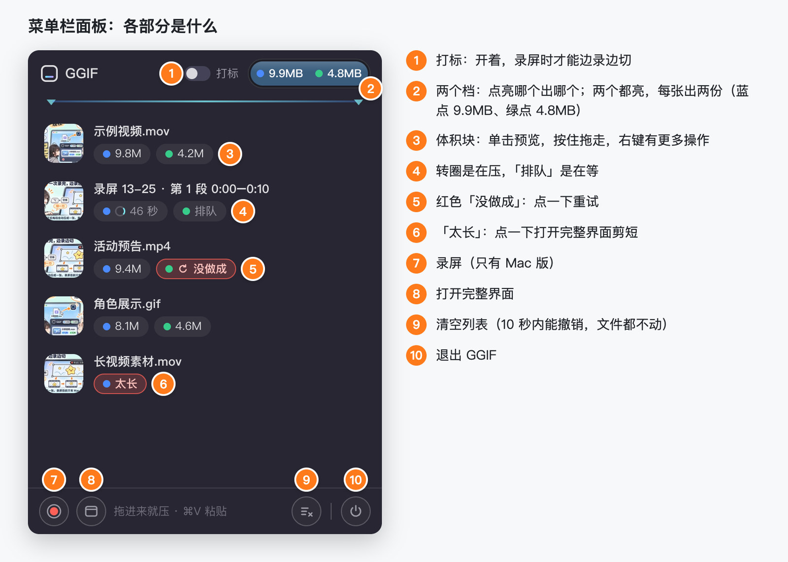

## 2. 装上它

要求：Mac 是 macOS 14 及以上；Windows 是 Windows 10 或 11（64 位）。安装包在[发布页](https://github.com/NPCONTEXT/GGIF/releases)。

### Mac

1. Apple 芯片（M1、M2 等）的 Mac 用 `GGIF-版本号-arm64.dmg`，Intel 芯片的用 `GGIF-版本号-Intel.dmg`。不知道是哪种，点屏幕左上角的苹果 →「关于本机」，看「芯片」或「处理器」那一行。
2. 打开对应芯片的 dmg，把 GGIF 拖到「应用程序」。
3. 第一次打开会被系统拦下（GGIF 没买苹果的开发者签名）：双击 GGIF，弹框点「完成」→ 打开「系统设置 → 隐私与安全性」，往下拉到「安全性」，点 GGIF 旁边的「仍要打开」→ 再点「仍要打开」，输入开机密码。以后直接打开就行。
4. 打开后屏幕右上角的菜单栏会出现 GGIF 的图标（一个圆角方框），GGIF 平时就待在这里。

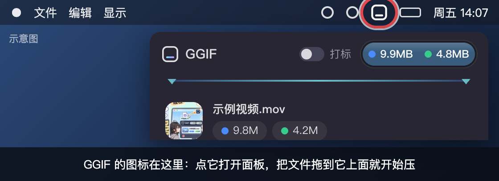

dmg 里也有一份「第一次打开看这里.txt」，写的是同样的步骤。

### Windows

1. 双击 `GGIF-版本号-Setup.exe`，会直接装好（装在你自己的用户目录，不要管理员密码），桌面和开始菜单会有 GGIF。
2. 弹出「Windows 已保护你的电脑」（GGIF 没买微软的签名）：点「更多信息」→「仍要运行」。
3. 如果只有「不运行」、没有「仍要运行」，或者提示被「智能应用控制」阻止：这是 Windows 11 的安全功能拦下了没签名的程序，GGIF 这边目前没有办法。
4. 装好后，任务栏右下角的托盘里会出现 GGIF 的图标（一个圆角方框）。Windows 11 可能把它藏在「^」里：点「^」，把 GGIF 图标拖到任务栏上，以后往它上面拖文件才方便。

Windows 上用法和 Mac 大体一样，不一样的地方见第 8 节。

## 3. 压现成的 GIF 和视频

- **拖到图标**：把视频或 GIF（或整个文件夹）拖到右上角的 GGIF 图标上，面板展开、顶上的「嘴」张开，松手就开始压。（Windows 是右下角托盘的图标，见第 8 节。）
- **双击 GIF（Mac）**：先设一次打开方式：右键一张 GIF →「显示简介」→「打开方式」选 GGIF →「全部更改…」。以后双击 GIF，菜单栏图标下面会弹出一个小条，压好显示体积，过几秒自己收起；结果在原文件旁边，叫「原文件名_压缩.gif」。
- 第一次压「下载」「桌面」「文稿」里的文件，系统会问「“GGIF”想访问“下载”文件夹中的文件。」，点「允许」。
- **两个档位**：面板顶上的 9.9MB 和 4.8MB 点亮哪个就出哪个，两个都亮就每张出两份（蓝点 9.9MB、绿点 4.8MB）；至少亮一个。
- **列表**：每行的体积块单击预览、按住拖走、右键有「在访达中显示」等更多操作；按住缩略图拖，拖的是顶上选中的那档。点行的空白处选中，⌘ 点加选、⇧ 点连选，选好后拖其中一个，就一起拖走。
- 转圈是在压，「排队」是在等；红色「没做成」点一下重试，「太长」点一下打开完整界面剪短。在访达里复制了文件，也可以打开面板按 ⌘V 粘贴进来。

| 拖到图标上，「嘴」张开，松手就压 | 两个档都亮着，每行两份结果 |
|---|---|
| 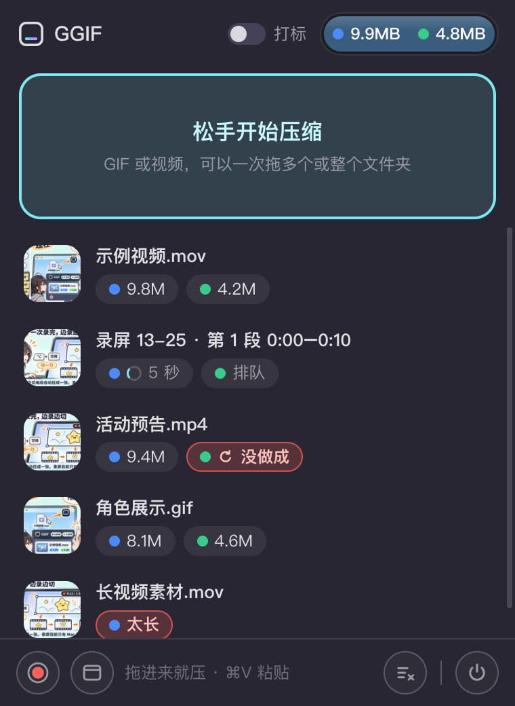 | 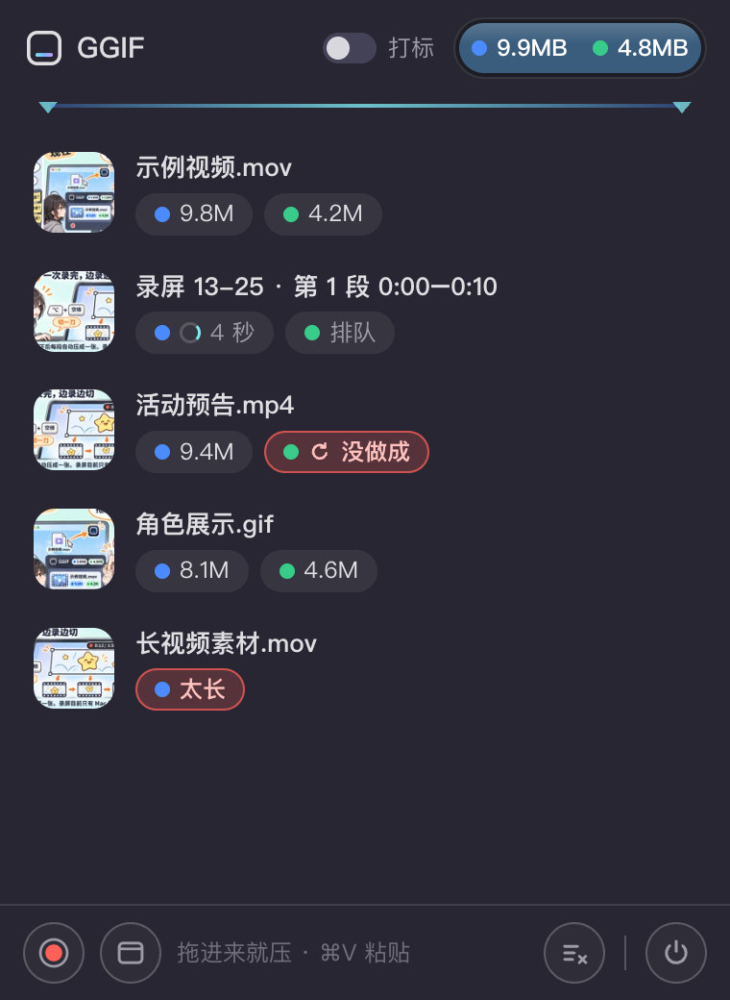 |

## 4. 录屏（Mac）

1. 按 ⌃⌥R（也可以点面板左下角的红点，或者双击菜单栏图标），系统先问录哪个：点「共享整个屏幕」；只录一个窗口，就点那个窗口上的「共享此窗口」。

   

2. 出现录制框（用上次的位置）和右上角的小胶囊：拖四角改大小，按住胶囊空白处挪。胶囊上有三样，选一次就记住：
   - 「打标」开着才能边录边切；关着就整段录成一份，录完在完整界面里挑一段压。
   - 「录完自动压」勾上，停了就自动压好（第一次记得勾）。
   - 「帧率」默认「高保真」；选 30、15、10、5 就按这个帧率录，导出也锁在这个帧率，录的时候更省电。一张 GIF 最多 300 帧，帧率越低能录得越长：30 帧最长 10 秒、15 帧 20 秒、10 帧 30 秒、5 帧 60 秒。

   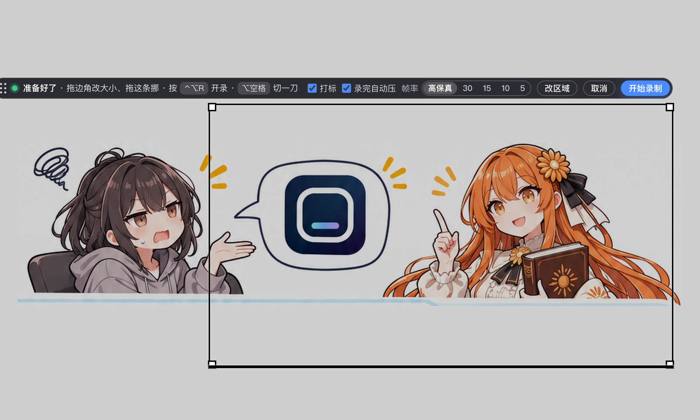

3. 点「开始录制」（或再按 ⌃⌥R）。开着「打标」时，录的时候按 ⌥空格 切一刀，切几刀就多出几段；点胶囊上的停止（或按 ⌃⌥R）停。最长 90 秒；没开打标或一刀没切，就整段一份。

   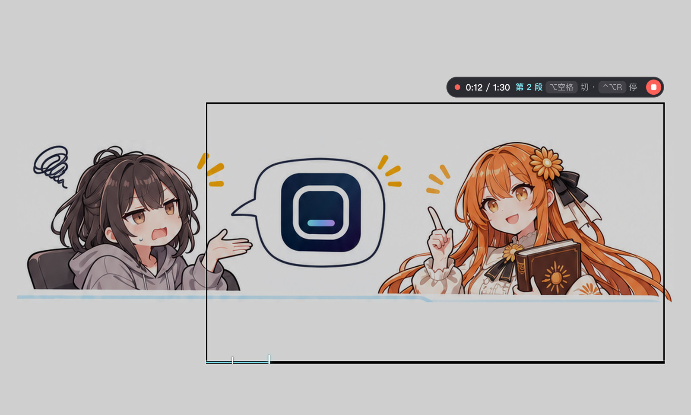

4. 停了以后每段进菜单栏列表、自动压好。没勾「录完自动压」的话，点面板顶上的「全部压缩」。

另外：

- 原始录像在「下载/GGIF录屏」，GGIF 不会自动删，记得偶尔清理。
- 录出来的画面不带鼠标，也不会录进 GGIF 自己的窗口。
- 录屏目前只有 Mac 版。

## 5. 发到公众号

- **9.9MB 那份**：拖进正文，或者在编辑器里点「图片 → 从图片库选择 → 上传文件」。别用「本地上传」：它 15 秒就超时，大图常常传不上。
- **4.8MB 那份**：复制粘贴用。在访达里复制文件粘进正文，或者先放进飞书文档、整篇复制粘到公众号（粘贴的上限是 5MB）。
- 拖进正文时，松手要落在正文里有字或有光标的那一行；落在左右两边、或最后一段下面的空白处，编辑器不接，浏览器会直接把图片打开在新标签页。这是公众号编辑器的规矩，从访达拖也一样。文章末尾要插图，就先按一下回车多出一行，再拖到那一行上。

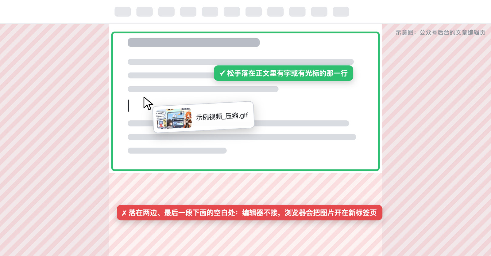

平台的这些规矩是作者 2026 年 10 月在自己的公众号上实测到的，会变；完整的一份见 [README 的「公众号的规矩」](../README.md#公众号的规矩)。

## 6. 完整界面：剪、裁、细调

打开：点菜单栏面板底下的「完整界面」按钮，或者双击列表里的一行；把视频或 GIF 拖进来（或者点「选择文件…」）。

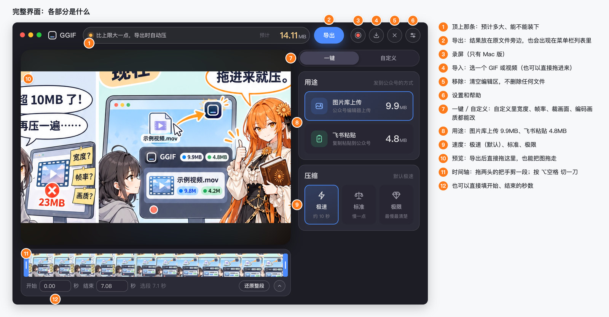

- **一键**：选用途（图片库上传 9.9MB、飞书粘贴 4.8MB）和速度。「极速」是默认，日常素材一般几秒到十来秒，难压的（动漫、游戏演出）会自动换高画质编码，二三十秒；「标准」多试几次、每次都检查画质；「极限」把几种编码逐一比较，最慢（可能要几分钟），画质最好。顶上那条会写预计多大、能不能装下。
- **剪**：拖时间轴两头的把手，或者直接填开始、结束的秒数；按 ⌥空格 在播放到的地方切一刀，每段各导出一张。
- **多选导出**：切了几段以后，⌘ 点段号多选（⇧ 点连选、⌘A 全选、Esc 取消），选两段以上导出时按时间顺序拼成一张；拼好的在菜单栏列表里单独一行。
- **自定义**：宽度、帧率、裁画面、编码画质、速度、循环……都能改，停一下就按当前参数真压一遍，告诉你实际多大。
- 导出的 GIF 放在原文件旁边：9.9MB 档叫「原文件名_压缩.gif」，4.8MB 档叫「原文件名_压缩_4.8M.gif」，原文件不动；导出后也会出现在菜单栏列表里，直接拖预览画面也能拖走。

| 一键：右边选用途和速度，顶上写预计多大 | 拖两头的把手剪一段再导出 |
|---|---|
|  |  |

| 刚打开：把视频或 GIF 拖进来 | 自定义：参数分四组，改完停一下就实测体积 |
|---|---|
| 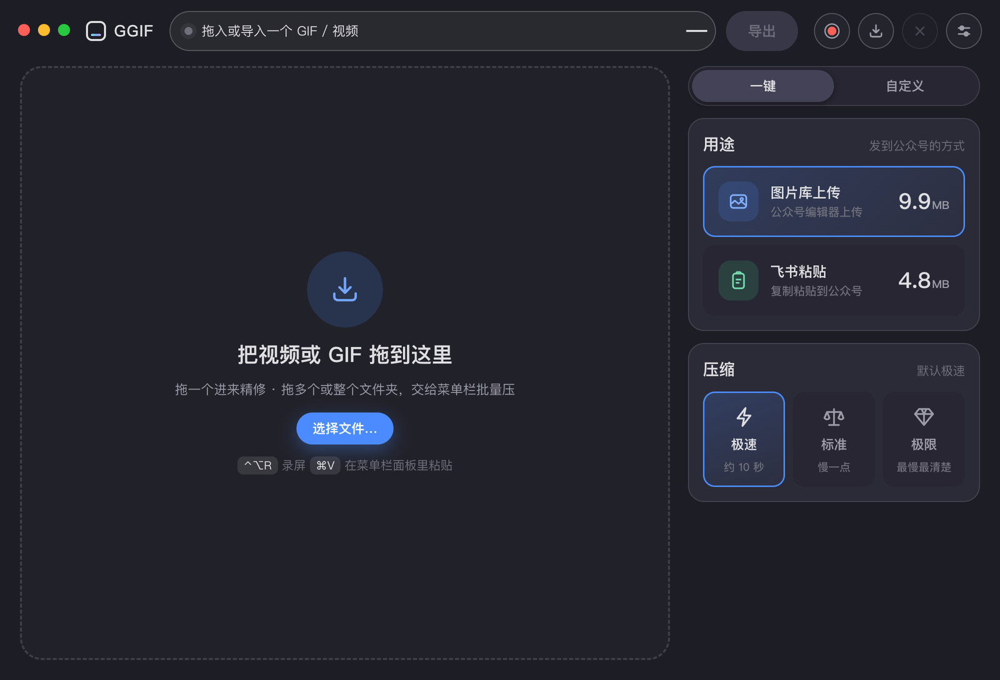 |  |

## 7. 设置

完整界面右上角最右边的按钮。能换录屏和切一刀的快捷键、开机启动、压完发通知、录屏打标、录完自动压、录制帧率、结果放原文件旁边还是统一放一个文件夹、录像放哪、凑到 61 帧的开关；Windows 上还有「屏幕边的投放块」（默认关）。「帮助」页有每个按钮的详细说明。

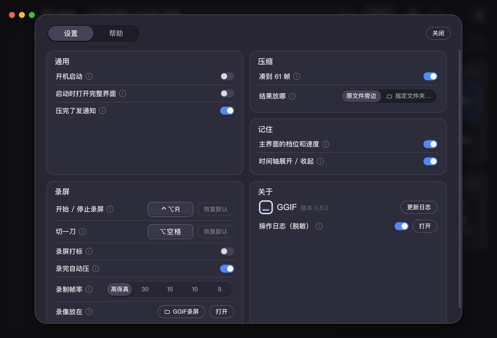

## 8. Windows 版有什么不一样

- **图标在右下角**：GGIF 待在任务栏右下角的托盘里；单击它开关面板，双击它打开完整界面。
- **拖文件**：把 GIF、视频拖到托盘的 GGIF 图标上，图标上方先冒出「文件拖到这，松手就压」；停一下面板弹出来、顶上的「嘴」张开，拖进面板松手就压（在那个提示小窗上松手也行）。
- **固定**：面板顶上的「固定」开着时，点别的窗口面板也不收，方便把压好的一张张拖进文章；关着就和 Mac 一样，点别处就收。
- **快捷键**：Mac 的 ⌘ 在 Windows 上都是 Ctrl：Ctrl 点多选、Ctrl+A 全选、Ctrl+V 粘贴、Ctrl+Delete 移到回收站；完整界面里切一刀是 Ctrl+B（Mac 是 ⌥空格），设置里能换。
- **这一版还没有**：录屏、双击 GIF 用 GGIF 打开。
- 万一拖到托盘图标没反应（比如图标藏在「^」里），可以打开设置 → 通用 →「屏幕边的投放块」：屏幕右边会出现一个小块，拖上去也能压。

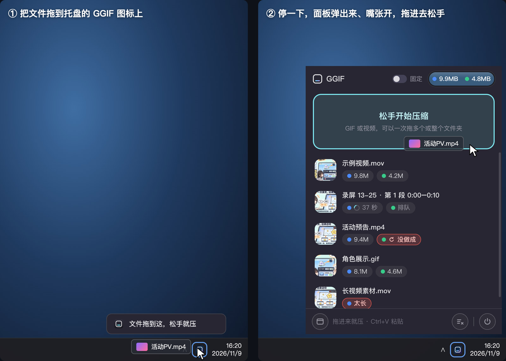

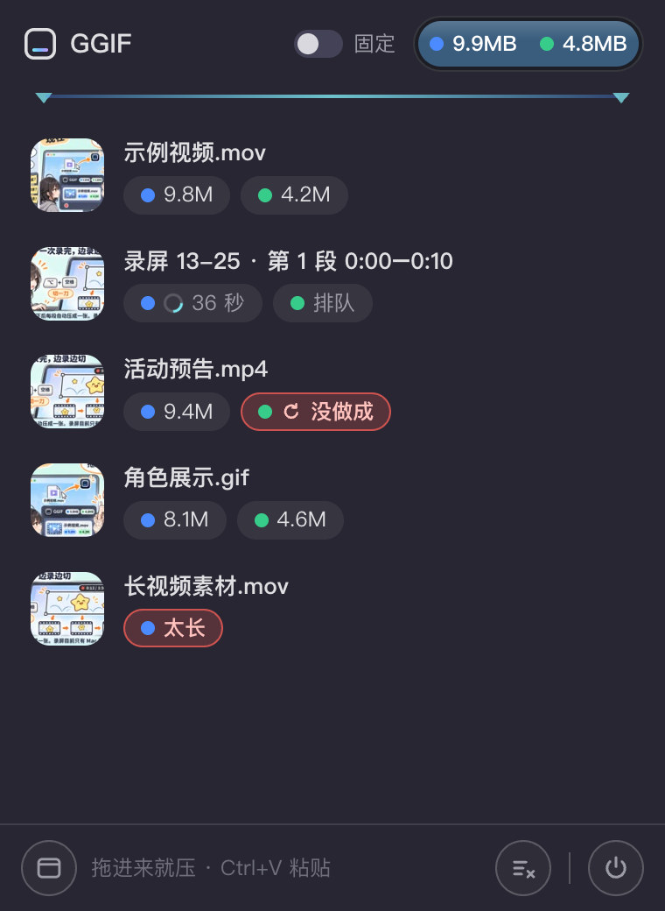

## 9. 注意

- Mac（Apple 芯片、Intel 芯片都有，macOS 14 起）和 Windows（10、11，64 位）都有；Windows 版这一版只有压缩。
- 素材上限：GIF 200MB、视频 100MB；更大的先用剪辑软件截一段再拖进来。
- 已知问题：录屏的框出来（胶囊上显示「准备好了」）以后，别直接退出 GGIF，先点胶囊上的「取消」；不然 GGIF 会退不干净，要到「活动监视器」里结束它。
- 没有自动更新；出了新版要自己到发布页再下。

## 10. 遇到问题

到仓库的 [Issues](https://github.com/NPCONTEXT/GGIF/issues) 提，截个图、说一下当时在做什么。第一次打开那一步如果和上面写的不一样（弹框、按钮名对不上），也欢迎截图告诉作者。

最好附上操作日志：完整界面右上角的设置 →「关于」里「操作日志（脱敏）」点「打开」，把当天那个 `GGIF-日期.log` 附上。日志只记操作和出错，文件名、路径、用户名都会换掉。
